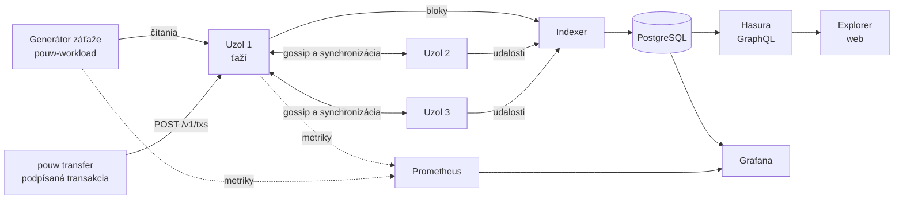

# Ako to funguje: jednoducho, pre demo

Táto stránka vysvetľuje celý projekt jednoduchými slovami, presne v tom
rozsahu, ktorý ukazujeme na deme 30. 11. Je pre toho, kto prezentuje, aj pre
toho, kto odpovedá na otázky. Poradie ukážok a záložný plán sú v
[Demo 30. 11.](demo.md), podrobnosti v [kontraktoch](../contracts/index.md) a
v README jednotlivých repozitárov.

## Projekt v troch vetách

V Bitcoine ťažiari počítajú hashe, ktoré okrem zabezpečenia siete nemajú
žiadny iný úžitok. My staviame vlastný blockchain (L1), v ktorom ťažiar
okrem hashovania vyrába aj **zero-knowledge dôkazy** pre klientov, ktorí si
ich objednajú a zaplatia poplatok. Práca ťažiara je teda zároveň užitočná
(*Proof of Useful Work*), myšlienka vychádza z článku
[SNARKChain](https://arxiv.org/abs/2510.09729).

## Slovník

| Pojem | Jednoducho |
| --- | --- |
| Blok | balík transakcií s hlavičkou; hlavička má 168 bajtov a ťažiar ju hashuje, kým nenájde dosť „malý“ hash |
| Transakcia | podpísaný príkaz, napríklad „pošli 1000 mincí z adresy A na adresu B“ |
| Ťažiar | uzol, ktorý skladá nové bloky a dostáva za ne odmenu |
| ZK dôkaz | krátky dôkaz, že niekto správne vykonal výpočet; overí sa rýchlo bez opakovania výpočtu |
| Groth16 | dôkazový systém, ktorý používa SNARKChain aj my |
| Uzol | program, ktorý drží celý reťazec, overuje bloky a rozpráva sa s ostatnými uzlami |
| Ľahký uzol | klient bez celého reťazca: má iba hlavičky blokov a pýta sa plných uzlov |
| Mempool | čakáreň transakcií, ktoré ešte nie sú v bloku |
| Devnet | naša testovacia sieť; má vlastný začiatočný blok (genesis) |
| Indexer | služba, ktorá číta bloky z uzla a ukladá ich do databázy, aby sa dali rýchlo hľadať |
| Explorer | webová stránka, na ktorej sa dajú prezerať bloky, transakcie a adresy |

## Celý obraz

Všetko beží v Dockeri na jednom serveri (staging), presne tak isto sa to dá
spustiť aj na notebooku príkazom `make up` v repozitári `pouw-deploy`.

## Časti projektu

### Uzol (pouw-node)

**Čo robí:** je srdcom siete. Prijíma transakcie, skladá a overuje bloky,
ukladá reťazec a rozpráva sa s ostatnými uzlami.

**Ako to funguje:**

- Napísaný je v Ruste. Blok má hlavičku so 168 bajtmi; ťažiar mení v hlavičke
  číslo (nonce) a hashuje ju, kým hash nie je pod cieľom (*proof of work*).
- Blok má okrem prevodov mincí (`txs`) aj miesto na dôkazy (`proof_txs`):
  dôkaz Groth16 pre požiadavku, ktorú si klient objednal a zaplatil. Každý
  uzol každý dôkaz v bloku overí, takže ťažiar nemôže podvádzať. V devnete
  sú `proof_txs` zatiaľ prázdne, pozri [Čo je hotové](#čo-je-hotové-a-čo-ešte-nie).
- Uzly sa navzájom nájdu a posielajú si bloky a transakcie cez libp2p
  (*gossipsub*). Nový uzol alebo uzol po výpadku si chýbajúce bloky stiahne
  sám (*initial block download*): najprv hlavičky, potom telá blokov.
- Uzol si chráni spojenia: má limity pripojení a zoznam zakázaných uzlov.
- Dáta ukladá do RocksDB, REST API je na porte 8000, metriky pre Prometheus
  na porte 9100.
- V tom istom obraze je CLI `pouw` (`keygen` vytvorí adresu, `transfer`
  podpíše transakciu) a ľahký uzol `pouw-light-node`.

**Čo ukážeme:** výšku reťazca, ako uzol 1 ťaží, ako uzly 2 a 3 držia rovnaký
vrchol reťazca, a skutočnú transakciu.

### Devnet s tromi uzlami

**Čo robí:** je to malá, ale skutočná sieť: tri uzly s rovnakým genesis
blokom.

**Ako to funguje:**

- Uzol 1 má adresu ťažiara, preto ťaží. Uzly 2 a 3 neťažia; pripoja sa k
  uzlu 1 (*bootnode*), bloky dostávajú cez gossip a overujú ich.
- Keď uzol vypadne, po štarte dobehne ostatné sám. Na stagingu sme to
  vyskúšali naostro: uzol 2 začal s prázdnou databázou a približne 9 000
  blokov stiahol od uzla 1 za asi 20 sekúnd.
- Ak sa devnet zasekne, `scripts/devnet-reset.sh` vytvorí nový genesis a
  začne od nuly.

**Čo ukážeme:** v Grafane → PoUW · Network panel *Height per node* a
*Peers*: všetky tri čiary výšky idú spolu.

### Cesta jednej transakcie

Toto je bod 3 dema, krok za krokom (príkazy sú v [Demo 30. 11.](demo.md)):

1. `pouw keygen` vytvorí novú adresu príjemcu.
2. Zistíme aktuálny nonce odosielateľa (poradové číslo jeho transakcií), aby
   sa tá istá transakcia nedala poslať dvakrát.
3. `pouw transfer` zostaví transakciu (komu, koľko, poplatok, nonce) a
   podpíše ju kľúčom odosielateľa (Ed25519).
4. Transakcia ide cez `POST /v1/txs` do uzla 1. Uzol overí podpis, nonce a
   zostatok a vráti `txid`, čiže hash transakcie.
5. Transakcia čaká v mempoole, kým ju ťažiar nevloží do ďalšieho bloku.
6. Indexer si nový blok prečíta z uzla a zapíše ho do databázy.
7. `txid` vložíme do vyhľadávania v exploreri a uvidíme transakciu v bloku,
   aj nový zostatok oboch adries.

### Indexer (pouw-indexer)

**Čo robí:** uzol vie odpovedať na jednoduché otázky („daj mi blok číslo
100“), ale nie na otázky typu „všetky transakcie tejto adresy“ alebo „koľko
blokov vyťažil každý ťažiar“. Na to indexer prepisuje reťazec do databázy
PostgreSQL.

**Ako to funguje:**

- Bloky číta z uzla 1, udalosti (napríklad „uzol videl nový blok“ alebo
  „transakcia bola odmietnutá“) zo všetkých troch uzlov.
- Pamätá si, kde skončil, takže po reštarte pokračuje a nezačína od nuly.
- Keď sa reťazec vetví (*reorg*), indexer to rozpozná a bloky, ktoré už
  neplatia, prestane zobrazovať.
- Raz za minútu počíta štatistiky siete pre Grafanu.

**Čo ukážeme:** v Grafane → PoUW · Services, že indexer je za uzlom menej
ako pár blokov.

### Explorer a Hasura (pouw-dashboard)

**Čo robí:** webová stránka, na ktorej sa dá prezerať celá sieť bez
inštalácie čohokoľvek.

**Ako to funguje:**

- Hasura z databázy automaticky robí GraphQL API. Vidí však iba pripravené
  pohľady (*views*), nie tabuľky indexera, a dovolí iba čítanie a iba
  vopred schválené dotazy. Cudzí dotaz dostane odpoveď `query is not allowed`.
- Web (React) má stránky: prehľad, zoznam blokov a detail bloku,
  transakcie, dôkazy, obvody (*circuits*), adresy, ťažba a vyhľadávanie.
- Nové bloky sa zobrazia samé, bez obnovenia stránky (GraphQL
  *subscriptions*).
- Na stránke sú vložené aj verejné panely z Grafany.

**Čo ukážeme:** prehľad, detail bloku, našu transakciu, adresu ťažiara so
zostatkom a stránku Ťažba.

### Generátor záťaže (pouw-workload)

**Čo robí:** hrá úlohu mnohých klientov naraz, aby sme videli, ako sieť
zvláda záťaž.

**Ako to funguje:**

- Napísaný je v Jave. Scenár v YAML hovorí, ako dlho, koľko požiadaviek za
  sekundu a aký mix požiadaviek posielať (vrchol reťazca, hlavička bloku,
  celý blok, účet).
- Požiadavky posiela podľa plánu bez ohľadu na to, či predchádzajúce už
  dostali odpoveď (*open loop*), takže meria skutočné oneskorenie aj pri
  preťažení.
- Meria oneskorenie p50, p95 a p99 (medián, 95 % a 99 % požiadaviek bolo
  rýchlejších) a posiela metriky do Prometheu.
- Scenár `devnet` beží 60 sekúnd, 20 čítaní za sekundu, z uzla 1.

**Čo ukážeme:** na serveri `make load SCENARIO=devnet` a počas behu v
Grafane → PoUW · Load test grafy *Reads / s*, *p95 latency* a *Errors*.

### Monitoring (Prometheus, Grafana, Alertmanager)

**Čo robí:** ukazuje, či je všetko zdravé, a keď nie je, pošle e-mail.

**Ako to funguje:**

- Prometheus každých pár sekúnd zbiera čísla (metriky) z uzlov, indexera,
  generátora aj zo samotného servera.
- Grafana z nich kreslí grafy, štyri dashboardy v priečinku PoUW:

| Dashboard | Čo na ňom je |
| --- | --- |
| PoUW · Network | výška, čas bloku, transakcie a dôkazy, obťažnosť, uzly a ich spojenia, mempool |
| PoUW · Services | či služby bežia, oneskorenie indexera, CPU a pamäť kontajnerov, reštarty |
| PoUW · Server | CPU, RAM, disk a sieť servera |
| PoUW · Load test | priebeh záťažového testu: čítania za sekundu, oneskorenie, chyby |

- Alertmanager pošle e-mail, keď napríklad uzol nebeží, reťazec 10 minút
  nerastie alebo je disk skoro plný.

### Server, CI/CD a nasadenie (pouw-deploy)

**Čo robí:** zabezpečuje, aby na stagingu vždy bežala otestovaná verzia.

**Ako to funguje:**

1. Každá zmena ide cez pull request. GitHub Actions spustia lint, testy a
   kontrolu bezpečnosti; zmena potrebuje zelenú kontrolu `ci-ok` a schválenie
   iného člena tímu.
2. Po merge sa z každej služby postaví Docker obraz.
3. Každý večer Jenkins spustí celú sieť od nuly v oddelenej kópii a pustí
   testy celej siete (napríklad: majú všetky uzly rovnaký genesis? držia
   rovnaký vrchol? vidí explorer skutočné bloky?).
4. Iba keď testy prejdú, otestované verzie sa nasadia na staging. Ak
   nová verzia nenaštartuje, nasadenie sa samo vráti na predchádzajúcu.
5. Každú noc o 02:00 UTC sa zálohuje databáza a obnova sa testuje.

Server je za proxy Caddy, ktorá sama vybaví HTTPS certifikáty. Zvonka sú
otvorené iba porty 80 a 443, SSH ide iba cez VPN školy.

| Čo | Adresa |
| --- | --- |
| Explorer | <https://explorer.147-175-151-18.sslip.io> |
| Grafana | <https://grafana.147-175-151-18.sslip.io> |
| Jenkins | <https://jenkins.147-175-151-18.sslip.io> |

## Čo je hotové a čo ešte nie

Hovoríme otvorene, čo je skutočné a čo je zjednodušené:

| Oblasť | Stav |
| --- | --- |
| Uzol, ťažba, transakcie, 3 uzly v sieti | hotové, beží na stagingu |
| Gossip a synchronizácia uzlov | hotové, uzly držia rovnaký vrchol |
| Indexer, explorer, monitoring, alerty, zálohy, CI/CD | hotové |
| Dôkazy v devnete | uzly na stagingu používajú *mock* dôkazovač (dôkaz sa nevyrába naozaj), aby ťažba nebola pomalá; skutočný Groth16 sa zapína nastavením `POUW_PROVER=groth16` |
| Viac dôkazových systémov | rozhodnuté sú tri ([ADR-0006](../decisions/0006-tri-dokazovacie-systemy.md)), implementovaný je zatiaľ Groth16 |
| Ľahký uzol | je v obraze uzla, synchronizuje hlavičky, ale v devnete ešte nebeží (pouw-node#105); generátor zatiaľ číta z uzla 1 |
| Scenáre záťaže | `devnet`, `smoke` a `soak` sú hotové, `steady` a `spike` sú v práci (pouw-workload#48) |
| Objednávky dôkazov od klientov | formát je v kontraktoch, ale nikto ich v devnete zatiaľ neposiela; bloky na stagingu majú `proof_txs` prázdne a obsahujú iba prevody mincí |

## Otázky, ktoré môžu prísť

**Prečo nestačí obyčajný proof of work?** Lebo jeho výpočet nemá žiadny iný
úžitok. U nás tá istá práca ťažiara vyrába dôkazy, za ktoré by klient inak
platil niekomu inému.

**Čo ak ťažiar pošle falošný dôkaz?** Každý uzol každý dôkaz v bloku overí.
Blok so zlým dôkazom ostatné uzly odmietnu, takže ťažiar príde o odmenu.

**Prečo práve tri uzly?** Najmenší počet, na ktorom sa dá ukázať, že sa uzly
nájdu, posielajú si bloky a jeden môže vypadnúť a dobehnúť ostatné.

**Odkiaľ explorer berie dáta? Pýta sa priamo uzla?** Nie. Uzol → indexer →
PostgreSQL → Hasura → explorer. Uzol tak nie je vystavený verejne a explorer
vie rýchlo odpovedať aj na zložité otázky.

**Čo keď server spadne?** Docker služby sám reštartuje, Alertmanager pošle
e-mail, databáza sa dá obnoviť z nočnej zálohy a celú sieť vieme spustiť aj
na notebooku (`make up`).

**Ako viete, že nová verzia nič nepokazila?** Každý večer Jenkins spustí
celú sieť od nuly a otestuje ju. Na staging ide iba verzia, ktorá testami
prešla.
