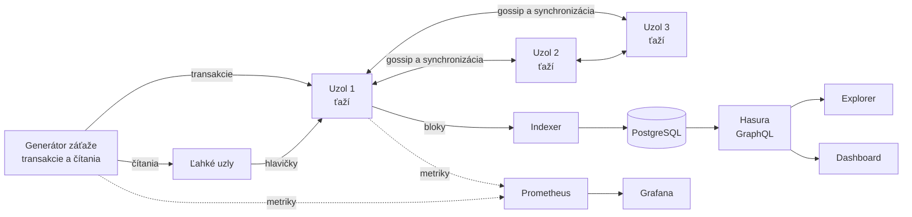

# Ako to funguje: jednoducho, pre demo

Táto stránka vysvetľuje projekt jednoduchými slovami, presne v tom rozsahu,
ktorý ukazujeme na deme 30. 11. Je pre toho, kto prezentuje, aj pre toho,
kto odpovedá na otázky. Poradie ukážok a záložný plán sú v
[Demo 30. 11.](demo.md), podrobnosti v [kontraktoch](../contracts/index.md) a
v README jednotlivých repozitárov.

## Čo ukazujeme

Vlastný **L1 blockchain, ktorý funguje ako Bitcoin**: ťažiari hashujú
hlavičky blokov a súťažia o odmenu, používatelia si posielajú mince a celá
sieť sa dá sledovať cez explorer a dashboard. Okolo siete je všetko, čo
potrebuje skutočný projekt: indexer a API, generátor záťaže, monitoring,
nasadenie na server cez Docker a nočné testy.

Cieľ projektu ide ďalej: ťažiari majú okrem hashovania vyrábať aj
zero-knowledge dôkazy pre klientov (*Proof of Useful Work*, podľa článku
[SNARKChain](https://arxiv.org/abs/2510.09729)). Táto časť je v návrhu a
kontraktoch, na deme ju neukazujeme (pozri [Čo je hotové](#čo-je-hotové-a-čo-ešte-nie)).

## Slovník

| Pojem | Jednoducho |
| --- | --- |
| L1 | samostatný blockchain s vlastnými uzlami a mincou, nie aplikácia nad iným blockchainom |
| Blok | balík transakcií s hlavičkou; hlavička má 168 bajtov a ťažiar ju hashuje, kým nenájde dosť „malý“ hash |
| Transakcia | podpísaný príkaz, napríklad „pošli 1000 mincí z adresy A na adresu B“ |
| Ťažiar | uzol, ktorý skladá nové bloky a dostáva za ne odmenu |
| Uzol | program, ktorý drží celý reťazec, overuje bloky a rozpráva sa s ostatnými uzlami |
| Ľahký uzol | klient bez celého reťazca: má iba hlavičky blokov a pýta sa plných uzlov |
| Mempool | čakáreň transakcií, ktoré ešte nie sú v bloku |
| Reorg | dvaja ťažiari našli blok naraz; vyhrá reťazec s väčšou prácou, druhý blok sa zahodí |
| Devnet | naša testovacia sieť; má vlastný začiatočný blok (genesis) |
| Indexer | služba, ktorá číta bloky z uzla a ukladá ich do databázy, aby sa dali rýchlo hľadať |
| Explorer | webová stránka, na ktorej sa dajú prezerať bloky, transakcie a adresy |

## Celý obraz

Všetko beží v Dockeri na jednom serveri (staging). Presne tak isto sa to dá
spustiť aj na notebooku príkazom `make up` v repozitári `pouw-deploy`.

## Časti projektu

### Uzol (pouw-node)

**Čo robí:** je srdcom siete. Prijíma transakcie, ťaží a overuje bloky,
ukladá reťazec a rozpráva sa s ostatnými uzlami.

**Ako to funguje:**

- Napísaný je v Ruste. Ako v Bitcoine má blok hlavičku (168 bajtov) a ťažiar
  v nej mení číslo (nonce) a hashuje ju (SHA-256), kým hash nie je pod
  cieľom (*proof of work*). Cieľ sa sám prispôsobuje, aby blok vznikol
  približne každých 10 sekúnd.
- Na rozdiel od Bitcoinu používame účty (ako Ethereum): každá adresa má
  zostatok a nonce, transakcia je podpísaná kľúčom Ed25519.
- Uzly sa navzájom nájdu a posielajú si bloky a transakcie cez libp2p
  (*gossipsub*). Nový uzol alebo uzol po výpadku si chýbajúce bloky stiahne
  sám (*initial block download*): najprv hlavičky, potom telá blokov.
- Uzol si chráni spojenia: má limity pripojení a zoznam zakázaných uzlov.
- Dáta ukladá do RocksDB, REST API je na porte 8000, metriky pre Prometheus
  na porte 9100.
- V tom istom obraze je CLI `pouw` (`keygen` vytvorí adresu, `transfer`
  podpíše transakciu) a ľahký uzol `pouw-light-node`.

### Sieť: traja ťažiari

**Čo robí:** je to malá, ale skutočná sieť ako Bitcoin: tri uzly s rovnakým
genesis blokom a každý z nich ťaží.

**Ako to funguje:**

- Všetky tri uzly súťažia o každý blok. Kto nájde hash skôr, pošle blok
  ostatným a dostane odmenu na svoju adresu.
- Keď dvaja nájdu blok naraz, sieť sa na chvíľu rozdvojí. Vyhrá reťazec s
  väčšou prácou, druhý blok sa zahodí (*reorg*) a indexer ho prestane
  zobrazovať.
- Keď uzol vypadne, po štarte dobehne ostatné sám. Na stagingu sme to
  vyskúšali naostro: uzol s prázdnou databázou stiahol približne 9 000 blokov
  za asi 20 sekúnd.
- Ak sa devnet zasekne, `scripts/devnet-reset.sh` vytvorí nový genesis a
  začne od nuly.

**Čo ukážeme:** v Grafane → PoUW · Network panely *Blocks per miner* (bloky
nachádzajú všetci traja), *Height per node* (výšky idú spolu) a *Peers*.

### Cesta jednej transakcie

Toto je bod 3 dema, krok za krokom (príkazy sú v [Demo 30. 11.](demo.md)):

1. `pouw keygen` vytvorí novú adresu príjemcu.
2. Zistíme aktuálny nonce odosielateľa (poradové číslo jeho transakcií), aby
   sa tá istá transakcia nedala poslať dvakrát.
3. `pouw transfer` zostaví transakciu (komu, koľko, poplatok, nonce) a
   podpíše ju kľúčom odosielateľa.
4. Transakcia ide cez `POST /v1/txs` do uzla. Uzol overí podpis, nonce a
   zostatok, vráti `txid` (hash transakcie) a pošle ju ostatným uzlom.
5. Transakcia čaká v mempoole, kým ju niektorý ťažiar nevloží do bloku.
6. Indexer si nový blok prečíta z uzla a zapíše ho do databázy.
7. `txid` vložíme do vyhľadávania v exploreri a uvidíme transakciu v bloku,
   aj nový zostatok oboch adries.

### Indexer (pouw-indexer)

**Čo robí:** uzol vie odpovedať na jednoduché otázky („daj mi blok číslo
100“), ale nie na otázky typu „všetky transakcie tejto adresy“ alebo „koľko
blokov vyťažil každý ťažiar“. Na to indexer prepisuje reťazec do databázy
PostgreSQL, ako indexery Bitcoinu alebo Etherea.

**Ako to funguje:**

- Sleduje uzol 1: číta nové bloky, zostatky účtov a udalosti zo všetkých
  troch uzlov (napríklad „uzol videl nový blok“ alebo „transakcia bola
  odmietnutá“).
- Pamätá si, kde skončil, takže po reštarte pokračuje a nezačína od nuly.
- Pri reorgu rozpozná, ktoré bloky už neplatia, a označí ich.
- Raz za minútu počíta štatistiky siete pre Grafanu.

**Čo ukážeme:** v Grafane → PoUW · Services, že indexer je za uzlom menej
ako pár blokov.

### Hasura: API pre weby

**Čo robí:** z databázy indexera automaticky robí GraphQL API, ktoré
používa explorer aj dashboard.

**Ako to funguje:**

- Vidí iba pripravené pohľady (*views*), nie tabuľky indexera, a dovolí iba
  čítanie a iba vopred schválené dotazy. Cudzí dotaz dostane odpoveď
  `query is not allowed`.
- Okrem dotazov vie posielať zmeny naživo (GraphQL *subscriptions* cez
  WebSocket), takže nový blok sa na webe zobrazí bez obnovenia stránky.

### Explorer a dashboard (pouw-dashboard)

**Čo robí:** dve webové stránky nad tým istým API:

- **Explorer** je ako blockchain.com pre Bitcoin: posledné bloky, detail
  bloku a transakcie, adresy so zostatkom, ťažiari a vyhľadávanie podľa
  výšky, hashu, `txid` alebo adresy.
- **Dashboard** ukazuje stav siete: uzly a ich výšky, ťažiarov, transakcie za
  sekundu, mempool a panely z Grafany.

**Čo ukážeme:** posledné bloky naživo, detail bloku, našu transakciu, adresu
ťažiara so zostatkom, stránku Ťažba a dashboard počas záťaže.

### Generátor záťaže (pouw-workload)

**Čo robí:** hrá úlohu mnohých používateľov naraz: posiela transakcie a
číta zo siete, aby sme videli, ako sieť zvláda záťaž.

**Ako to funguje:**

- Napísaný je v Jave. Scenár v YAML hovorí, ako dlho, koľko požiadaviek za
  sekundu a aký mix poslať (prevody mincí, vrchol reťazca, hlavička bloku,
  celý blok, účet).
- Transakcie posiela do plných uzlov, čítania cez ľahké uzly.
- Požiadavky posiela podľa plánu bez ohľadu na to, či predchádzajúce už
  dostali odpoveď (*open loop*), takže meria skutočné oneskorenie aj pri
  preťažení.
- Meria oneskorenie p50, p95 a p99 (medián, 95 % a 99 % požiadaviek bolo
  rýchlejších) a posiela metriky do Prometheu.

**Čo ukážeme:** na serveri `make load SCENARIO=devnet` a počas behu v
Grafane → PoUW · Load test grafy *Reads / s*, *p95 latency* a *Errors*, v
exploreri bloky plné prevodov.

### Monitoring (Prometheus, Grafana, Alertmanager)

**Čo robí:** ukazuje, či je všetko zdravé, a keď nie je, pošle e-mail.

**Ako to funguje:**

- Prometheus každých pár sekúnd zbiera čísla (metriky) z uzlov, indexera,
  generátora aj zo samotného servera.
- Grafana z nich kreslí grafy, štyri dashboardy v priečinku PoUW:

| Dashboard | Čo na ňom je |
| --- | --- |
| PoUW · Network | výška, čas bloku, bloky podľa ťažiara, transakcie, obťažnosť, uzly a ich spojenia, mempool |
| PoUW · Services | či služby bežia, oneskorenie indexera, CPU a pamäť kontajnerov, reštarty |
| PoUW · Server | CPU, RAM, disk a sieť servera |
| PoUW · Load test | priebeh záťažového testu: požiadavky za sekundu, oneskorenie, chyby |

- Alertmanager pošle e-mail, keď napríklad uzol nebeží, reťazec 10 minút
  nerastie alebo je disk skoro plný.

### Server, Docker, Jenkins (pouw-deploy)

**Čo robí:** zabezpečuje, aby na stagingu vždy bežala otestovaná verzia.

**Ako to funguje:**

1. Každá služba má `Dockerfile`. Celá sieť (uzly, indexer, databáza, Hasura,
   weby, generátor, monitoring, Jenkins) je opísaná v jednom `compose.yml`.
2. Každá zmena ide cez pull request. GitHub Actions spustia lint, testy a
   kontrolu bezpečnosti; zmena potrebuje zelenú kontrolu `ci-ok` a schválenie
   iného člena tímu. Po merge sa z každej služby postaví Docker obraz.
3. Každý večer o 21:00 Jenkins spustí celú sieť od nuly v oddelenej kópii a
   pustí testy jednotlivých častí aj celej siete, napríklad:
   - majú všetky uzly rovnaký genesis a nájdu sa?
   - rastie reťazec a držia uzly rovnaký vrchol?
   - nachádza bloky viac ťažiarov?
   - stíha indexer uzol a dáva Hasura ten istý blok ako uzol?
   - príde nový blok cez subscription?
   - dostane sa skutočná transakcia až do explorera?
   - dá sa obnoviť nočná záloha?
4. Iba keď testy prejdú, otestované verzie sa nasadia na staging. Ak nová
   verzia nenaštartuje, nasadenie sa samo vráti na predchádzajúcu.
5. Každú noc o 02:00 UTC sa zálohuje databáza.

Server je za proxy Caddy, ktorá sama vybaví HTTPS certifikáty. Zvonka sú
otvorené iba porty 80 a 443, SSH ide iba cez VPN školy.

| Čo | Adresa |
| --- | --- |
| Explorer | <https://explorer.147-175-151-18.sslip.io> |
| Grafana | <https://grafana.147-175-151-18.sslip.io> |
| Jenkins | <https://jenkins.147-175-151-18.sslip.io> |

## Čo je hotové a čo ešte nie

Stav k 19. 11., pred demom ho aktualizujte:

| Oblasť | Stav |
| --- | --- |
| Uzol: ťažba, transakcie, gossip, synchronizácia | hotové, beží na stagingu |
| Traja ťažiari | v pull requeste (pouw-deploy#65) |
| Indexer, Hasura, explorer | hotové, beží na stagingu |
| Monitoring, alerty, zálohy, Docker, nočné testy v Jenkinse | hotové |
| Generátor: čítania a meranie oneskorenia | hotové |
| Generátor: transakcie | v práci (pouw-workload) |
| Ľahké uzly v devnete | ľahký uzol je v obraze uzla, v devnete ešte nebeží (pouw-node#105) |
| Stránka dashboardu | v práci (pouw-dashboard#82); záloha: verejné panely Grafany |
| Proof of Useful Work (dôkazy v blokoch) | ďalšia fáza: formát je v kontraktoch, uzly zatiaľ bežia s *mock* dôkazovačom a bloky majú `proof_txs` prázdne (pouw-node#92) |

## Otázky, ktoré môžu prísť

**Čím sa líši od Bitcoinu?** Na deme takmer ničím, a to je zámer: najprv
funkčná L1 so všetkým okolo. Rozdiely: účty namiesto UTXO, blok každých 10
sekúnd a v ďalšej fáze dôkazy pre klientov v blokoch.

**Kde je Proof of Useful Work?** V návrhu a kontraktoch (formát bloku má
miesto pre dôkazy). Implementujeme ho v ďalšej fáze nad touto sieťou.

**Čo keď dvaja ťažiari nájdu blok naraz?** Na chvíľu existujú dve vetvy.
Vyhrá tá s väčšou prácou, ostatné uzly sa na ňu prepnú a indexer zahodený
blok prestane zobrazovať.

**Prečo práve tri uzly?** Najmenší počet, na ktorom sa dá ukázať súťaž
ťažiarov, šírenie blokov a uzol, ktorý vypadne a dobehne ostatné.

**Odkiaľ explorer berie dáta? Pýta sa priamo uzla?** Nie. Uzol → indexer →
PostgreSQL → Hasura → explorer. Uzol tak nie je vystavený verejne a explorer
vie rýchlo odpovedať aj na zložité otázky.

**Čo keď server spadne?** Docker služby sám reštartuje, Alertmanager pošle
e-mail, databáza sa dá obnoviť z nočnej zálohy a celú sieť vieme spustiť aj
na notebooku (`make up`).

**Ako viete, že nová verzia nič nepokazila?** Každý večer Jenkins spustí
celú sieť od nuly a otestuje ju. Na staging ide iba verzia, ktorá testami
prešla.
